# Diagrams

One picture per route, plus the router that chooses between them.

These used to live at the bottom of each worker's markdown file. Everything below a worker's
frontmatter is the prompt, so each diagram was sent to the model on every run and then explicitly
skipped by a closing instruction telling it to ignore the section. They were about 240 lines across
the eight workers, and in the release worker's case 21 of its 48 prompt lines. They are documentation
for people, so they live here, and `verify-route-matrix.sh` fails if one reappears in a prompt.

Every diagram uses the same shapes and the same palette, so reading one teaches you the rest:

| Shape | Means |
|---|---|
| Rounded, indigo | a job that does something |
| Square, amber | a decision the workflow or the agent makes |
| Doubled circle, green | a terminal state that made progress |
| Doubled circle, red | a terminal state that needs a person |
| Doubled circle, dark | nothing to do, the run ends idle |
| Dotted arrow | the unhappy path |

Each worker diagram also names the rung each stage sits on, from the determinism ladder in
`skills/workflow-author`: the lower the rung, the cheaper and more reproducible the decision.

---

## The router

Every trigger the repository has arrives here, and exactly one thing happens per event. Nothing
else in the system subscribes to a public event, which is what makes a route addable or removable
without touching the others.

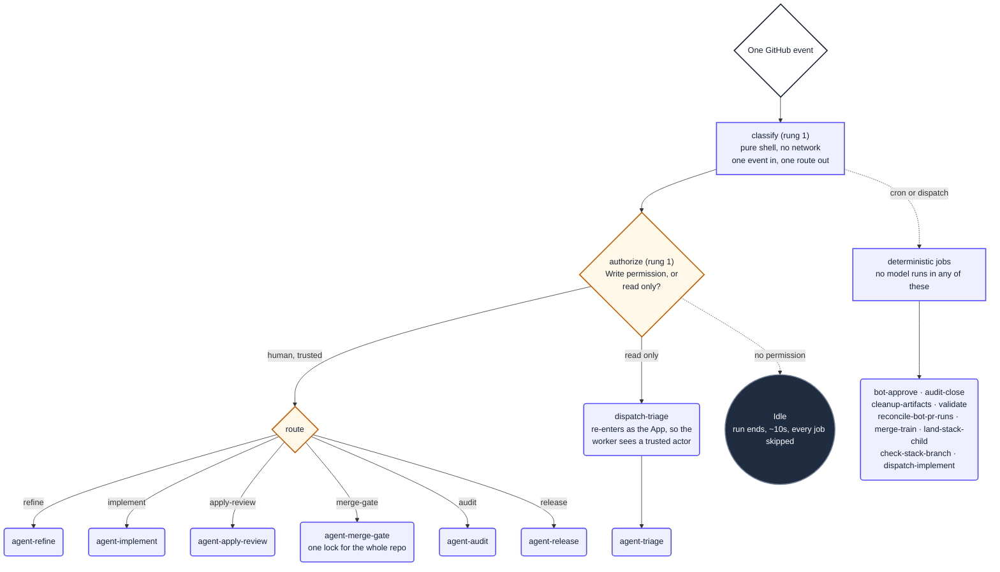

A run still appears for every matching event even when the router decides nothing downstream
happens; those cost about ten seconds with every job skipped. Reducing the count means generating
fewer events, not adding more guards.

### How the routes chain

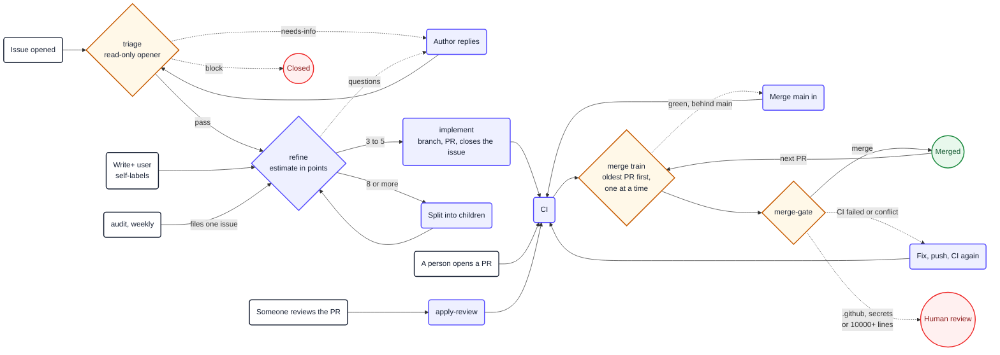

Audit creates work rather than consuming it, and files into `refine` rather than straight to
`implement`, so a report of several unrelated findings becomes one properly sized issue per finding
instead of one pull request that has to fix them all.

### The merge train

One pull request moves at a time, the lowest number first, whoever opened it. Everything else waits
untouched, so a merge never invalidates work in flight. A pull request a person has to decide on is
passed by, so it never blocks the line. The train ticks on every merge, every CI completion, after
every gate, and hourly as the fallback.

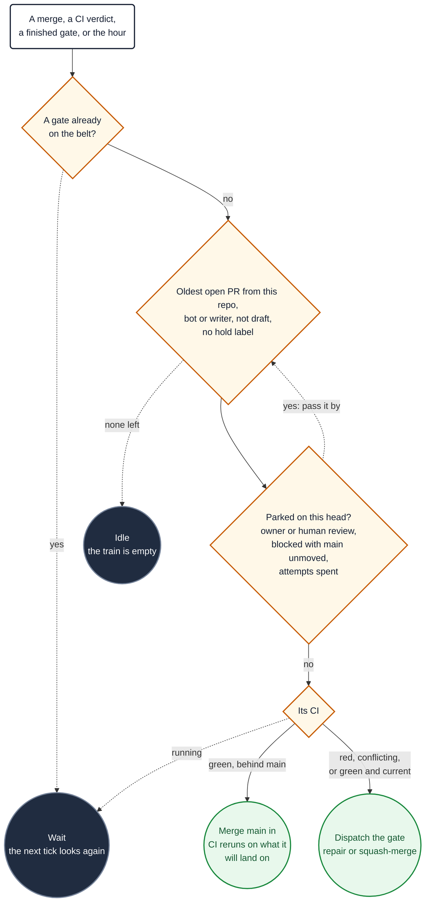

### How a feature stacks

When refine splits a story that carries real sequencing — a feature whose children build on each
other — the split can open a stack instead of independent work. The children stay ordinary issues
walking the normal pipeline above; only where they land changes: each child's pull request targets
the feature branch rather than the default branch, and one root pull request (spec plus the
feature's acceptance journey, open from the start) carries the whole feature to `main` at the end.

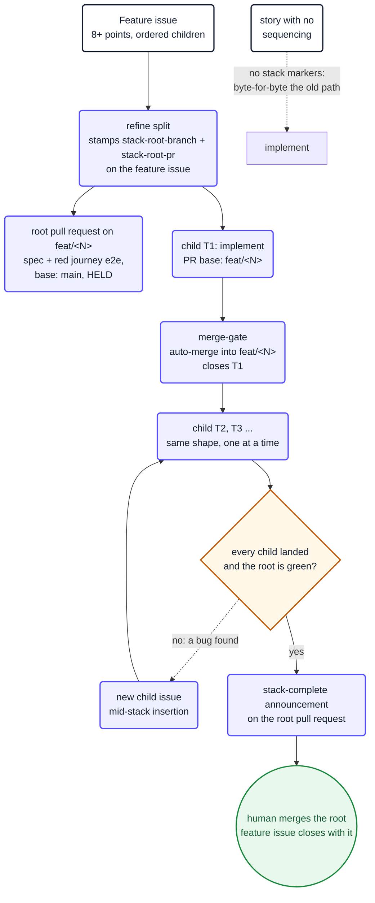

The stack exists only in markers on the issues — `stack-root-branch` and `stack-root-pr` on the
feature issue, `stack-root-branch` stamped on each child at hand-over — so a repository with none
of them runs exactly the pipeline above and nothing else. The root is never auto-merged: a person
merges it after every child has landed and the feature branch is green, which is the point where
the feature's own acceptance journey, not one child's scope, is the thing being verified.

---

## agent-triage.md

The front door for issues opened by people with read-only access. The gate is permission level, not
membership: anybody with write skips triage and self-labels into the pipeline, org member or not, while
a read-only outside collaborator goes through it.

Four outcomes, and only one of them closes anything. `needs-maintainer` is the one worth knowing: the
request is legitimate but addressed to the wrong intake, so the issue stays open with `review` and a
maintainer takes it on by adding `refine`.

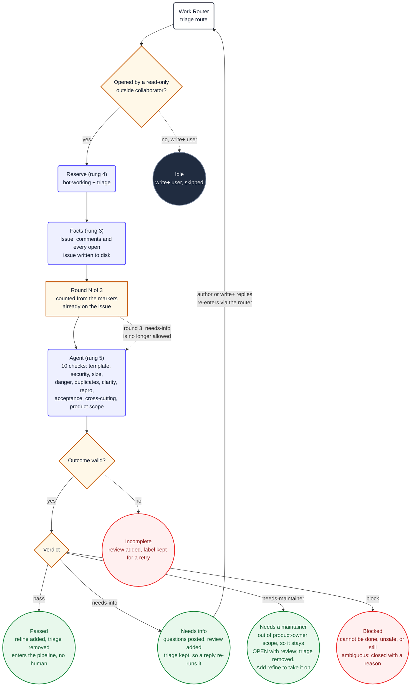

---

## agent-refine.md

Decides the size of the work, which is the decision that determines whether it ever lands. An
estimate of 8 or more is split into children of 3 to 5 points, and each child walks the pipeline
alone. A slice smaller than 3 points is a fragment and is folded into a sibling.
The refined story is wrapped in the repository's own issue form, and when questions remain the
worker leaves a temporal draft on the issue and asks everything in one batched comment.

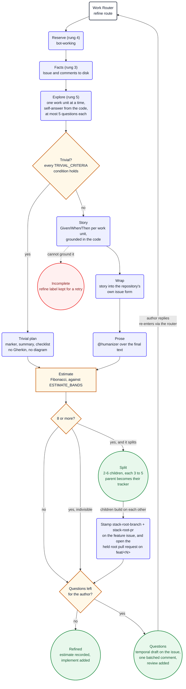

---

## agent-implement.md

Writes the code and opens one pull request. It stops there: the merge decision belongs to the gate,
because waiting for CI inside this run would hold a fleet machine doing nothing.

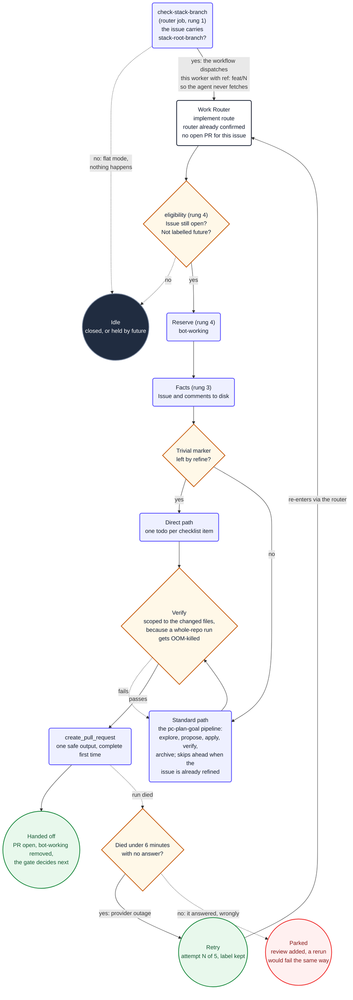

The retry belt exists because a provider outage kills a run in a couple of minutes with no answer,
and that used to burn the issue and hand it to a human. A run that worked for half an hour and then
failed produced an answer that was wrong; repeating it costs the whole fleet the same half hour to
be wrong again, so only the short deaths are retried.

A stacked child enters the same worker through a different door: the router's `check-stack-branch`
job reads the issue's markers before anything runs, and dispatches the compiled workflow with
`ref:` set to the feature branch, because the agent sandbox has no credentials to fetch or choose
a branch itself. The prompt then tells `create_pull_request` its base: the feature branch for a
stacked child, the default branch for everything else. Nothing about the standard path above
changes for an issue without the markers.

---

## agent-merge-gate.md

The only worker that merges. It runs one at a time for the whole repository, because several
overnight pull requests mean every merge moves the default branch under the rest.

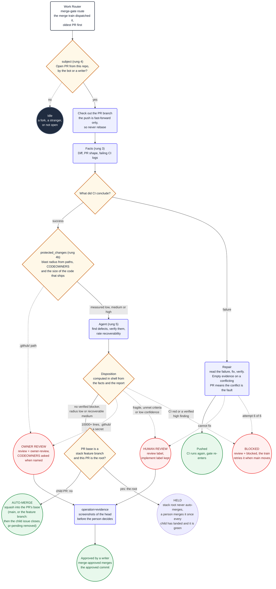

For a child pull request — one whose base is a stack feature branch — everything above is
unchanged: the risk assessment sees the same diff it always would, and auto-merge means squash
into the feature branch, closing exactly that child issue. The root pull request is the one
exception in the whole system: it can be as clean as any merge that ever shipped and the gate
still will not take it, because a feature is only done when the whole branch is done. AABB holds
it with an App-token comment and a person takes it from there, after the router's stack-completion
check has announced that every child landed and the branch is green.

A protected-path match holds the merge but does not stop the repair path: the agent may still fix
failed CI on those files, and `conclude` is what refuses to merge them.

The agent does not pick the disposition. It reports what it found and what it verified; the
validator computes the outcome from that report and from the blast radius measured before the
agent ran. A category the diff touches is no longer, on its own, a reason to park a pull request:
only a verified high or critical finding, a sensitive path, or a change that would be hard to undo
sends it to a person.

Size counts only code that ships: tests, docs, specs, translations and generated migration code
(`BLAST_IGNORE_PATHS`) are left out, and a new EF Core migration whose `Up()` only creates and adds
is a medium change rather than an owner one. When the gate parks a pull request for a person it
dispatches `operation=evidence`, so the screenshots arrive before the decision, and an approval
from anyone with write access merges the approved commit (`merge-approved` in the router).

---

## agent-apply-review.md

Applies a reviewer's feedback to a pull request the bot already opened, and pushes to the same
branch.

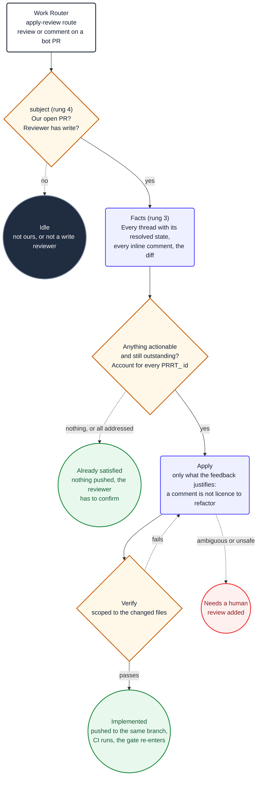

A reviewer often makes one point across several comments, so the whole conversation is on disk
before anything changes. Applying them one at a time produces contradictory commits.

---

## agent-audit.md

The only worker that creates work rather than consuming it. Read-only: it files an issue and
changes nothing.

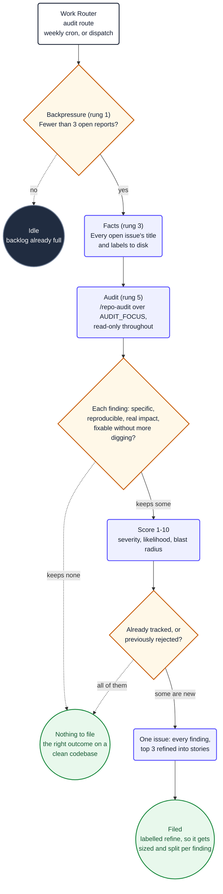

Memory matters here: open issues only cover what is still open, so a finding reported weeks ago and
consciously not acted on would come back every single run. The audit records its dispositions and
reads them next time.

---

## agent-release.md

Manual dispatch only. The agent writes prose; deterministic jobs do everything irreversible, and
nothing reaches `main` except through a pull request.

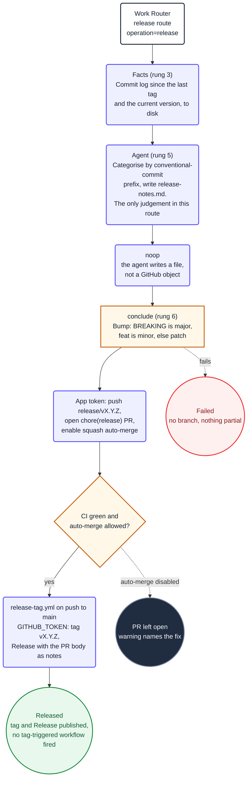

The version bump, the tag and the Release are deterministic on purpose. The agent's only output is
a file on disk, so a confused model cannot publish a release. The tag and the Release use
`GITHUB_TOKEN` so that a consumer deploying on `v*` tags does not deploy because a release was cut.

---

## housekeeping

Not a worker: a deterministic job in the router, on its own six-hourly cron, with no model. It is
the answer to a specific measured problem. Across the four consumers, 58 of 237 issues closed since
1 August were closed by the bot; autonomy ran between 6% and 50%. The gap was not bad decisions, it
was silence work that stopped and told nobody, and state that nothing ever cleaned up.

The one rule that shapes it: **retry a failure, report a decision.** A crash, a timeout or an empty
output is a machine failure, and the worker marks it `stalled`; those are worth running again. A
triage `needs-maintainer`, a refine `questions` or a merge-gate `review` is a verdict the agent
reached on purpose, and running it again just reproduces it.

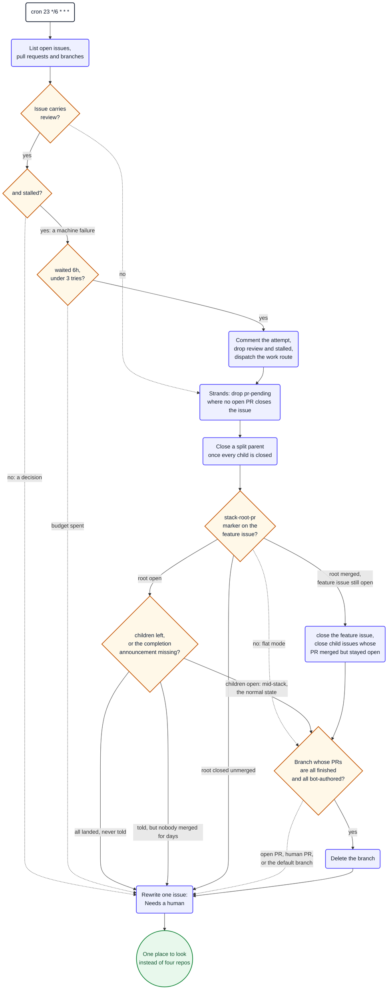

Three things make it safe to leave running unattended. It uses the App token, because GitHub starts
no workflow run from an event raised with `GITHUB_TOKEN`, so with the default token every retry
would be a green no-op. Every write goes through one `act()` wrapper, which is the only place
`dry-run` is read, so there is no second path that forgets to check it. And it closes exactly two
kinds of issue a split parent whose children are all done, and its own digest which the route
matrix asserts by counting.

The stack section extends the same two rules to stacked features without adding a third closed
kind: a merged child whose issue stayed open is closed exactly like a flat split parent (its work
landed, the close was lost to a race), and a merged root closes the feature issue the same way
section 3 closes a split parent. Everything else about a stack is a *report*, never an action:
mid-stack is the normal state and stays silent; a root that finished but was never announced, one
held for days after its announcement, a root closed by accident with children open, and a missing
root pull request each get one line in the digest. No labels move, so nothing the router listens
for is raised by the sweep itself.

---

## agentics-app-errors

An optional template, installed only where there is an Application Insights resource to read, and
the mirror image of `agentics-error-report` below it. That one carries a *workflow* failure out of a
private consumer into the public package, so it is built to send almost nothing. This one reads the
*application's* own exceptions, and they are the private repository's own business: the issue is
filed beside the code that threw it and nothing travels anywhere.

It runs no model, for the reason that one does not: a model asked to summarise a stack trace
paraphrases it, and a paraphrased stack trace is a wrong issue that costs somebody an afternoon. The
agent work happens afterwards, on the belt, because the issue is labelled `bug` + `refine` and that
is the same handoff the audit already uses.

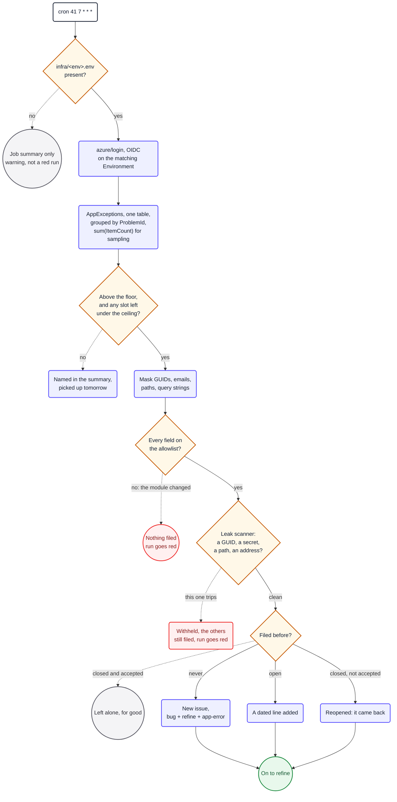

Two failures, handled two different ways, and the difference is the point. A field nobody agreed to
publish means the module changed and the new field is probably on every finding, so nothing is filed
at all. A body that still trips the scanner after scrubbing is one unlucky row: that report is
withheld and the rest are filed, because one bad operation name must never mean the belt stops
hearing about anything. Both turn the run red.

Scrubbing comes before scanning for the same reason. Masking a GUID keeps the job alive where
refusing over one would have left it red every morning and filing nothing, which is how a workflow
gets switched off. The scanner is the backstop for whatever the masks missed, not the first line.

The route matrix asserts the query names one table and only inside the query itself, that counts are
summed rather than counted, that the reportable field set has not grown a run id, that the scrubs and
the scanner both still exist, that both `setFailed` paths are intact, and that no model has appeared.
Every one was mutation-tested. Four of the first drafts used the file's own `count()` helper inside
an `if`, and since that helper is `grep || true` those guards were true whatever they found: they
failed open, which is the exact bug this section exists to catch.

---

## agentics-error-report

An optional template, installed everywhere, and the only job in the fleet that sends anything out of
the repository it runs in. Every consumer is private, so that is the whole design constraint.

What crosses the boundary is a fixed, enumerable set of facts about workflows **this package ships**:
their file names, their job and step names, a conclusion, a runner label, a count, and the id of a
matched entry from a catalogue of sixteen known failure shapes, plus a severity. What never crosses it is free text
of any kind no log line, no branch name, no issue title, no path, no URL, no number that could be
looked up. Hence no model: a model asked to summarise a failure paraphrases whatever the log held.

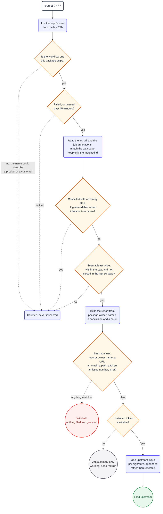

The scanner fails closed, and its failure is loud: a report it flags is not filed and the run goes
red, so the field that carried private text gets fixed rather than leaking again the next morning.
The route matrix asserts the scanner exists, that both exit paths call `setFailed`, that there are
at least as many scans as upstream writes, that each individual check is still present, and that no
model or `OPENAI_API_KEY` has appeared in the action. Every one of those was mutation-tested; three
earlier versions of them passed against a deliberately broken guard and were rewritten.

---

## evidence.yml

Archives what a merged pull request looks like. Not an agent: the plan was written by the agent that
implemented the change (`pc-repo-verify`), and this replays it. The router calls it when a pull
request merges, and `operation=evidence` runs it by hand. Nothing waits on it. The screenshots are
committed beside each plan, in an `evidence/` folder on the default branch, so the record stays with
the change it proves; the comment embeds a manifest that Project Health reads. The merge gate also
runs it when it hands a pull request to a person: that pull request is not merged, so its
screenshots go to a preview folder (`pr-<number>/`) on the `evidence-previews` branch, and the
merge replaces them with the archived ones.
The capture job runs the pull request's code with a read-only token; only the publish job writes,
and it runs no repository code.

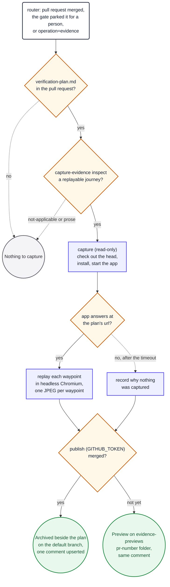
